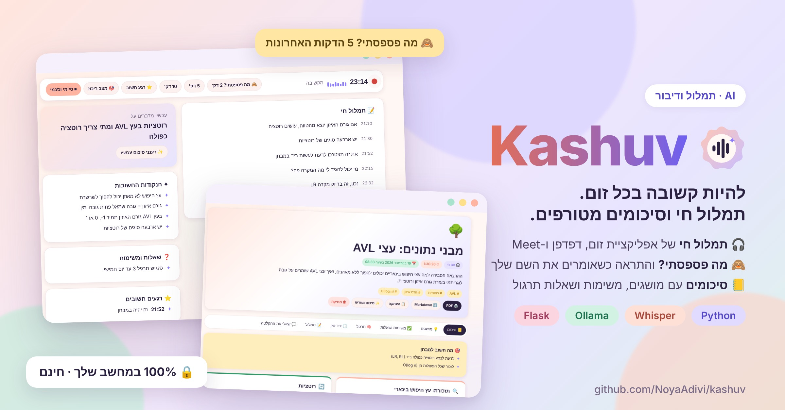
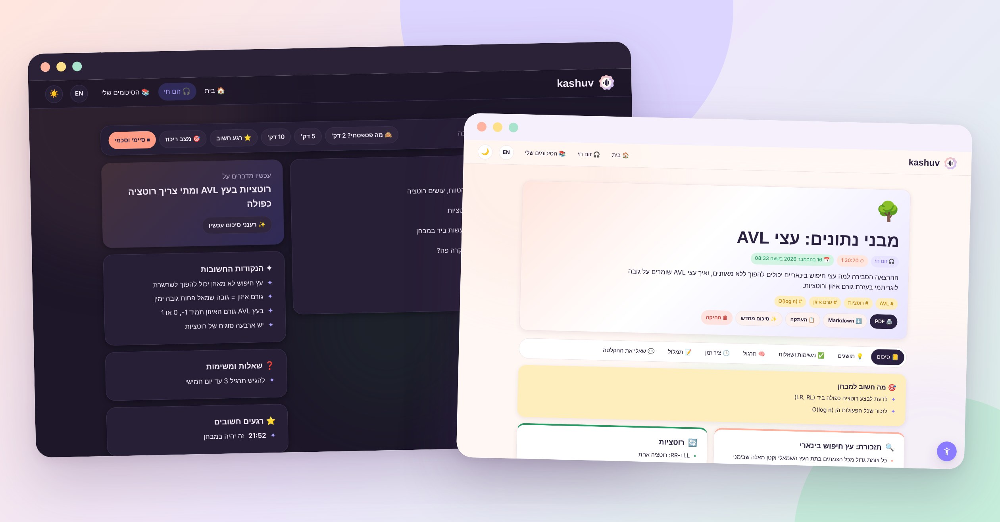
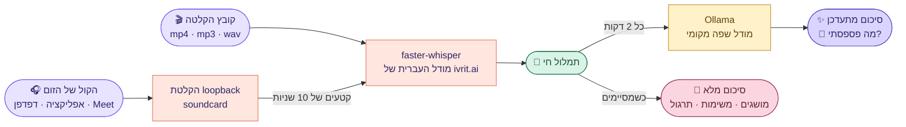

<div dir="rtl">

<p align="center">
  <a href="#run-locally"></a>
</p>

<p align="center"><a href="README.md"></a></p>

<p align="center">
  <a href="#run-locally"></a>
  <a href="https://github.com/NoyaAdivi/kashuv/archive/refs/heads/main.zip"></a>
  <a href="#how-it-works"></a>
</p>

<p align="center">
  <a href="LICENSE"></a>
  <a href="https://github.com/NoyaAdivi/kashuv/commits/main"></a>
  <a href="https://github.com/NoyaAdivi/kashuv"></a>
  
</p>

<h3 align="center">להיות קשובה בכל זום, ולא לאבד את החוט אף פעם.</h3>

<p align="center">
  Kashuv מקשיבה לפגישות יחד איתך, מתמללת בזמן אמת,<br>
  מתריעה כשמישהו אומר את השם שלך, והופכת כל הרצאה ל<b>סיכום שבאמת אפשר ללמוד ממנו</b>.<br>
  הכל רץ במחשב שלך. בלי מנויים, בלי ענן, בלי עלות.
</p>

<table align="center">
  <tr>
    <td align="center" width="25%"><a href="#how-it-works"><b>🎙️ עברית קודם</b></a><br><sub>מודל הדיבור של ivrit.ai</sub></td>
    <td align="center" width="25%"><a href="#highlights"><b>⚡ כ-10 שניות</b></a><br><sub>מהדיבור ועד הטקסט</sub></td>
    <td align="center" width="25%"><a href="#tech-stack"><b>💸 0 ₪</b></a><br><sub>מודלים חינמיים בקוד פתוח</sub></td>
    <td align="center" width="25%"><a href="#privacy"><b>🔒 100%</b></a><br><sub>מקומי, שום דבר לא עולה</sub></td>
  </tr>
</table>

<p align="center">
  <a href="#run-locally"></a>
</p>

<a name="highlights"></a>
<p align="center"><a href="#see-it-in-action"></a></p>

<table dir="rtl">
  <tr valign="top">
    <td valign="top" width="33%">
      <p><b>🎧 זום חי</b></p>
      <ul>
        <li><b>שומעת את מה שהמחשב משמיע:</b> אפליקציית זום, זום בדפדפן, Meet, Teams</li>
        <li><b>תמלול חי</b> כל כמה שניות, ואם רוצים גם המיקרופון שלך</li>
        <li><b>סיכום מתעדכן:</b> "על מה מדברים עכשיו"</li>
        <li><b>שומרת את ההקלטה</b> כקובץ WAV</li>
      </ul>
    </td>
    <td valign="top" width="33%">
      <p><b>🎯 עזרה להתרכז</b></p>
      <ul>
        <li><b>🙈 מה פספסתי?</b> 2, 5 או 10 הדקות האחרונות בלחיצה</li>
        <li><b>📣 התראת שם:</b> צליל והדגשה כשקוראים לך</li>
        <li><b>⭐ רגעים חשובים</b> שאפשר לסמן עם הערה</li>
        <li><b>מצב ריכוז</b> שמשאיר רק את העיקר</li>
      </ul>
    </td>
    <td valign="top" width="33%">
      <p><b>📒 סיכומים שאפשר ללמוד מהם</b></p>
      <ul>
        <li><b>כל הקלטה:</b> mp4, m4a, mp3, wav ועוד</li>
        <li><b>תקציר, חלקים, מה חשוב למבחן,</b> מושגים, משימות, ציר זמן וכרטיסיות תרגול</li>
        <li><b>תמלול לחיץ</b> שעוקב אחרי ההקלטה, עם חיפוש</li>
        <li><b>💬 שאלי את ההקלטה</b> כל שאלה, וייצוא ל-PDF או Markdown</li>
      </ul>
    </td>
  </tr>
</table>

<a name="see-it-in-action"></a>
<p align="center"><a href="#how-it-works"></a></p>

<p align="center">
  
</p>

<p align="center">
  <b>🎧 זום חי</b> · <b>📒 סיכום</b> · <b>🧠 תרגול</b> · <b>📝 תמלול</b> · <b>💬 שאלות</b> · <b>🌙 מצב כהה</b> · <b>♿ תפריט נגישות</b>
</p>

<a name="how-it-works"></a>
<p align="center"><a href="#tech-stack"></a></p>



<p align="center"><sub>פגישות ארוכות מסוכמות בחלקים ואז מאוחדות (map-reduce), והמודל תמיד עונה ב-JSON מסודר כדי שהעמוד אף פעם לא יישבר.</sub></p>

<a name="tech-stack"></a>
<p align="center"><a href="#run-locally"></a></p>

<p align="center"><b>שרת</b><br>
<a href="https://www.python.org"></a>
<a href="https://flask.palletsprojects.com"></a>
<a href="https://numpy.org"></a>
</p>

<p align="center"><b>בינה מלאכותית, הכל מקומי</b><br>
<a href="https://github.com/SYSTRAN/faster-whisper"></a>
<a href="https://huggingface.co/ivrit-ai"></a>
<a href="https://ollama.com"></a>
<a href="https://ai.google.dev/gemma"></a>
</p>

<p align="center"><b>צד לקוח</b><br>
<a href="https://developer.mozilla.org/docs/Web/JavaScript"></a>
<a href="https://developer.mozilla.org/docs/Web/CSS"></a>
<a href="https://developer.mozilla.org/docs/Web/API/Web_Audio_API"></a>
</p>

<a name="run-locally"></a>
<p align="center"><a href="#contact"></a></p>

1. להתקין [Python 3.10 ומעלה](https://www.python.org/downloads/) ולסמן **Add to PATH**.
2. להתקין [Ollama](https://ollama.com/download) ולהוריד את מודל הסיכומים:
   ```bash
   ollama pull gemma3:4b
   ```
3. לחיצה כפולה על **`start.bat`**. בפעם הראשונה נוצרת סביבה וירטואלית, הכל מותקן ומודל הדיבור בעברית יורד (בערך 1.6GB). אחר כך Kashuv נפתחת בכתובת `http://localhost:5170`.

> [!TIP]
> מחשב איטי? להגדיר `KASHUV_WHISPER=small`. מחשב חזק? לנסות `KASHUV_LLM=qwen2.5:7b`. כל ההגדרות נמצאות ב-[`kashuv/config.py`](kashuv/config.py).

> [!NOTE]
> זום חי מקליט את הרמקול הראשי עם WASAPI loopback ב-Windows. ב-Mac צריך התקן loopback כמו BlackHole.

<details>
<summary><b>📂 מבנה הפרויקט</b></summary>

```
├── app.py              שרת Flask: עמודים, העלאות, פגישות חיות, API
├── kashuv/
│   ├── config.py       מודלים, פורט ונתיבים (אפשר לשנות במשתני סביבה)
│   ├── transcribe.py   faster-whisper, נטען פעם אחת
│   ├── live.py         הקלטת loopback, חלוקה לקטעים, התראת שם, סיכום מתעדכן
│   ├── summarize.py    הנחיות ל-Ollama, map-reduce, ניקוי JSON, שאלות
│   └── storage.py      פגישות כקבצי JSON בתיקייה data/
├── templates/          index.html
├── static/             app.js (ניתוב ותצוגות), a11y.js, style.css, logo.svg
├── docs/               התמונות של ה-README
└── start.bat           התקנה והפעלה בלחיצה אחת ב-Windows
```
</details>

<a name="privacy"></a>
<details>
<summary><b>🔒 פרטיות</b></summary>
<br>
הקול, התמלולים והסיכומים לא יוצאים מהמחשב שלך. הם נשמרים בתיקייה המקומית <code>data/</code>, שלא עולה ל-git. תמיד לספר למשתתפים שמקליטים.
</details>

<a name="contact"></a>
<p align="center"><a href="https://www.linkedin.com/in/noya-adivi/"></a></p>

<p align="center">
  <a href="https://github.com/NoyaAdivi/kashuv"></a>
  <a href="https://www.linkedin.com/in/noya-adivi/"></a>
  <a href="https://noyaadivi.github.io/noya-website"></a>
  <a href="https://github.com/NoyaAdivi"></a>
</p>

</div>
