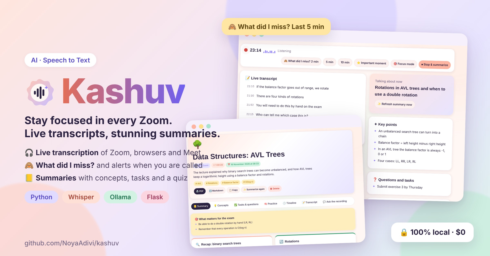
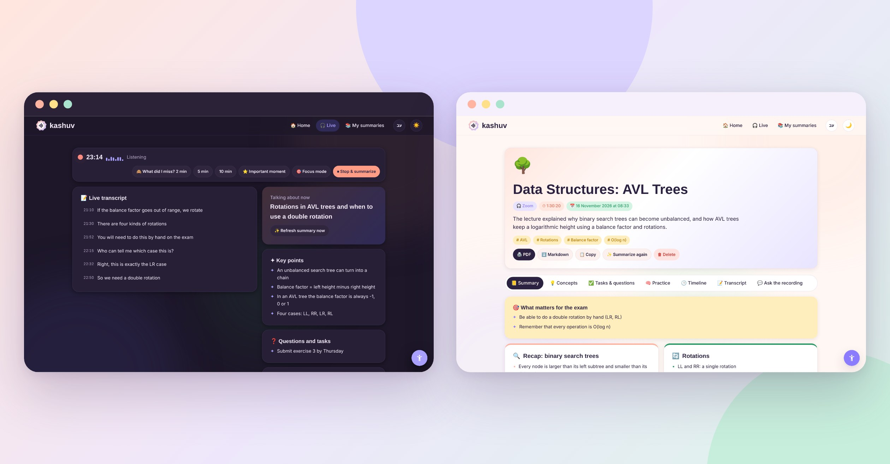
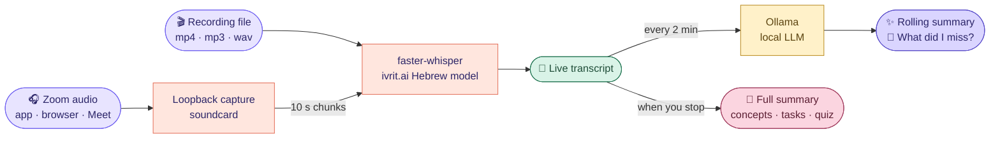

<p align="center">
  <a href="#run-locally"></a>
</p>

<p align="center"><a href="README.he.md"></a></p>

<p align="center">
  <a href="#run-locally"></a>
  <a href="https://github.com/NoyaAdivi/kashuv/archive/refs/heads/main.zip"></a>
  <a href="#how-it-works"></a>
</p>

<p align="center">
  <a href="LICENSE"></a>
  <a href="https://github.com/NoyaAdivi/kashuv/commits/main"></a>
  <a href="https://github.com/NoyaAdivi/kashuv"></a>
  
</p>

<h3 align="center">Stay focused in every Zoom. Never lose the thread again.</h3>

<p align="center">
  Kashuv ("attentive" in Hebrew) listens to your meetings with you, transcribes them live,<br>
  tells you when someone says your name, and turns every lecture into <b>notes worth studying from</b>.<br>
  Everything runs on your own computer. No subscriptions, no cloud, no cost.
</p>

<table align="center">
  <tr>
    <td align="center" width="25%"><a href="#how-it-works"><b>🎙️ Hebrew first</b></a><br><sub>ivrit.ai speech model</sub></td>
    <td align="center" width="25%"><a href="#highlights"><b>⚡ ~10 s</b></a><br><sub>from speech to live text</sub></td>
    <td align="center" width="25%"><a href="#tech-stack"><b>💸 $0</b></a><br><sub>free, open-source models</sub></td>
    <td align="center" width="25%"><a href="#privacy"><b>🔒 100%</b></a><br><sub>local, nothing uploaded</sub></td>
  </tr>
</table>

<p align="center">
  <a href="#run-locally"></a>
</p>

<a name="highlights"></a>
<p align="center"><a href="#see-it-in-action"></a></p>

<table>
  <tr valign="top">
    <td valign="top" width="33%">
      <p><b>🎧 Live Zoom mode</b></p>
      <ul>
        <li><b>Hears what your computer plays:</b> the Zoom app, Zoom in the browser, Meet, Teams</li>
        <li><b>Live transcript</b> every few seconds, plus your own mic if you want</li>
        <li><b>Rolling summary:</b> "what are they talking about right now"</li>
        <li><b>Saves the recording</b> as a WAV file</li>
      </ul>
    </td>
    <td valign="top" width="33%">
      <p><b>🎯 Focus helpers</b></p>
      <ul>
        <li><b>🙈 What did I miss?</b> The last 2, 5 or 10 minutes in one click</li>
        <li><b>📣 Name alert:</b> a sound and a highlight when you are called</li>
        <li><b>⭐ Important moments</b> you can bookmark with a note</li>
        <li><b>Focus mode</b> that hides everything but the essentials</li>
      </ul>
    </td>
    <td valign="top" width="33%">
      <p><b>📒 Summaries worth studying</b></p>
      <ul>
        <li><b>Drop any recording:</b> mp4, m4a, mp3, wav and more</li>
        <li><b>TL;DR, sections, exam tips,</b> concepts, tasks, timeline and a flip-card quiz</li>
        <li><b>Clickable transcript</b> that follows the audio, with search</li>
        <li><b>💬 Ask the recording</b> anything, export to PDF or Markdown</li>
      </ul>
    </td>
  </tr>
</table>

<a name="app"></a>
<h3 align="center">📲 App and FAQ <sub><sup>new</sup></sub></h3>
<p align="center">Kashuv installs as a real app with its own icon, and the site answers common questions by topic.</p>

<table>
  <tr valign="top">
    <td width="50%">
      <ul>
        <li><b>📲 Installable app (PWA):</b> its own icon and window on phone and desktop, named just Kashuv</li>
        <li><b>⚡ Works offline</b> after the first visit, powered by a service worker</li>
      </ul>
    </td>
    <td width="50%">
      <ul>
        <li><b>❓ FAQ by topic:</b> filter chips, search with highlighting and smooth animations</li>
        <li><b>🔗 Built by Noya Adivi</b> with a LinkedIn link at the bottom of every page</li>
      </ul>
    </td>
  </tr>
</table>


<a name="see-it-in-action"></a>
<p align="center"><a href="#how-it-works"></a></p>

<p align="center">
  
</p>

<p align="center">
  <b>🎧 Live mode</b> · <b>📒 Summary</b> · <b>🧠 Quiz</b> · <b>📝 Transcript</b> · <b>💬 Ask</b> · <b>🌙 Dark mode</b> · <b>♿ Accessibility menu</b>
</p>

<a name="how-it-works"></a>
<p align="center"><a href="#tech-stack"></a></p>



<p align="center"><sub>Long meetings are summarized in parts and merged (map-reduce), and the model always answers in strict JSON so the page never breaks.</sub></p>

<a name="tech-stack"></a>
<p align="center"><a href="#run-locally"></a></p>

<p align="center"><b>Server</b><br>
<a href="https://www.python.org"></a>
<a href="https://flask.palletsprojects.com"></a>
<a href="https://numpy.org"></a>
</p>

<p align="center"><b>AI, all local</b><br>
<a href="https://github.com/SYSTRAN/faster-whisper"></a>
<a href="https://huggingface.co/ivrit-ai"></a>
<a href="https://ollama.com"></a>
<a href="https://ai.google.dev/gemma"></a>
</p>

<p align="center"><b>Front end</b><br>
<a href="https://developer.mozilla.org/docs/Web/JavaScript"></a>
<a href="https://developer.mozilla.org/docs/Web/CSS"></a>
<a href="https://developer.mozilla.org/docs/Web/API/Web_Audio_API"></a>
</p>

<a name="run-locally"></a>
<p align="center"><a href="#contact"></a></p>

1. Install [Python 3.10+](https://www.python.org/downloads/) and tick **Add to PATH**.
2. Install [Ollama](https://ollama.com/download) and download the summary model:
   ```bash
   ollama pull gemma3:4b
   ```
3. Double click **`start.bat`**. The first run creates a virtual environment, installs everything and downloads the Hebrew speech model (about 1.6 GB). Kashuv then opens at `http://localhost:5170`.

> [!TIP]
> Slow laptop? Set `KASHUV_WHISPER=small`. Strong PC? Try `KASHUV_LLM=qwen2.5:7b`. Every setting lives in [`kashuv/config.py`](kashuv/config.py).

> [!NOTE]
> Live mode records the default speaker with WASAPI loopback on Windows. On a Mac you need a loopback device such as BlackHole.

<details>
<summary><b>📂 Project structure</b></summary>

```
├── app.py              Flask server: pages, upload jobs, live sessions, API
├── kashuv/
│   ├── config.py       models, ports and paths (all overridable with env vars)
│   ├── transcribe.py   faster-whisper, loaded once and shared
│   ├── live.py         loopback capture, chunking, name alerts, rolling summary
│   ├── summarize.py    Ollama prompts, map-reduce, JSON cleanup, Q&A
│   └── storage.py      sessions as JSON files in data/
├── templates/          index.html
├── static/             app.js (router and views), a11y.js, style.css, logo.svg
├── docs/               README images
└── start.bat           one-click setup and start on Windows
```
</details>

<a name="privacy"></a>
<details>
<summary><b>🔒 Privacy</b></summary>
<br>
Audio, transcripts and summaries never leave your computer. They are saved in the local <code>data/</code> folder, which is ignored by git. Always tell the other participants that you are recording.
</details>

<a name="contact"></a>
<p align="center"><a href="https://www.linkedin.com/in/noya-adivi/"></a></p>

<p align="center">
  <a href="https://github.com/NoyaAdivi/kashuv"></a>
  <a href="https://www.linkedin.com/in/noya-adivi/"></a>
  <a href="https://noyaadivi.github.io/noya-website"></a>
  <a href="https://github.com/NoyaAdivi"></a>
</p>
